# ScrollNah

**[⬇ Download the latest APK](https://github.com/RAJASHEKARGUNAGANTI/scrollnah/releases/latest)** · Android 8.0+ · free, no account

A playful Android app that helps you scroll less, with a mascot that reacts to how much you scroll: **Blobby** the orange blob, or **Bloomy**, a plant that grows a flower for every week you stay under your limits.

- **Daily limits** for any app (a different one on weekends if you like), plus separate limits for **Instagram Reels** and **YouTube Shorts**.
- **Websites count too**: youtube.com, instagram.com and others in your browser use the same limits.
- **Three strictness levels**: Chill (a gentle nudge), Firm (a pause screen with a breath, then +5 minutes if you really want), Beast (locked until midnight).
- **Five moods**: your mascot goes from thriving to melting (or wilting) as you use up your day.
- **Break reminders** after a long stretch on one app, as a notification, a mascot bubble, or both.
- **Bloomy's garden**: four flowers fill a pot, and finished pots are kept in your garden. Bloomy celebrates every new flower.
- **Focus mode** (lock your apps for 30 min to 2 hours, or 30 min from a **Quick Settings tile**) and a **bedtime** schedule.
- **Home-screen widgets**: a card with today's numbers, a small one, and an animated mascot that bobs, sways and blinks right on your wallpaper.
- **A weekly report** that shows where the time went (per app, per day), when you scroll most, whether the nudges worked, a month calendar and a 4-week trend, plus your mascot's verdict and a swipeable **week in review** you can share as a picture.
- **Streaks**, and light and dark themes. Works with TalkBack.
- **Small**: about 1.4 MB.
- **Private by design**: no account, and everything stays on your phone. Read the [privacy policy](https://rajashekargunaganti.github.io/scrollnah/privacy-policy).

## Screenshots

| Home | Pause screen | Your week |
|:---:|:---:|:---:|
| 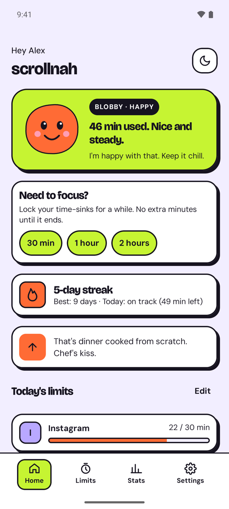 | 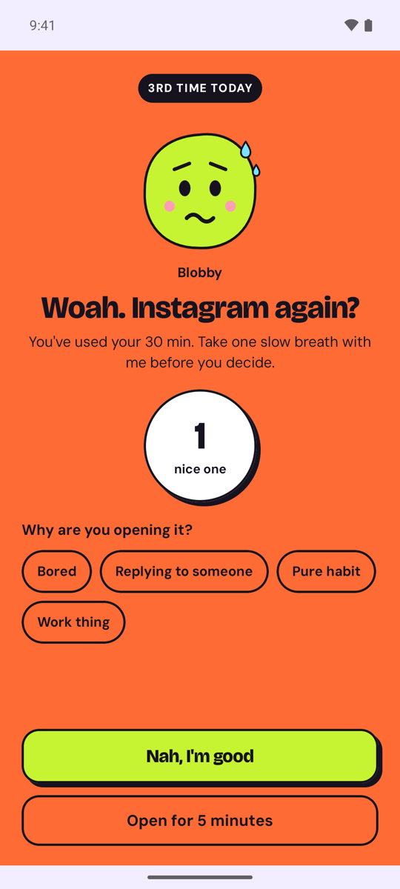 | 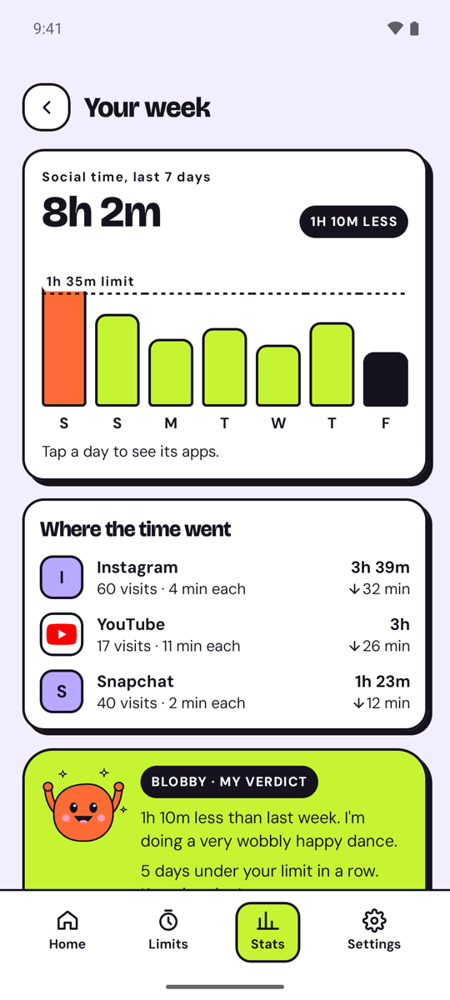 |
| **Limits (weekday and weekend)** | **Break reminders** | **A break reminder** |
| 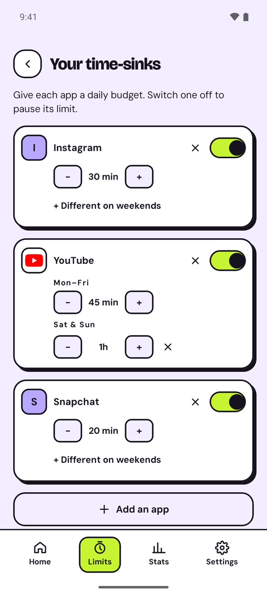 | 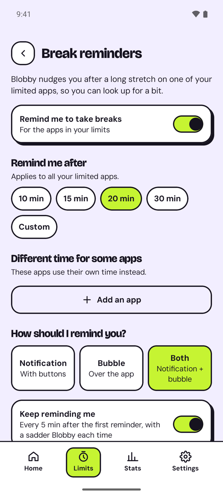 | 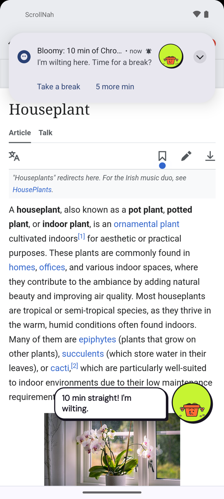 |
| **Bloomy on Home (next flower 5 of 7 days)** | **Settings: pick your mascot** | **Bloomy's garden** |
| 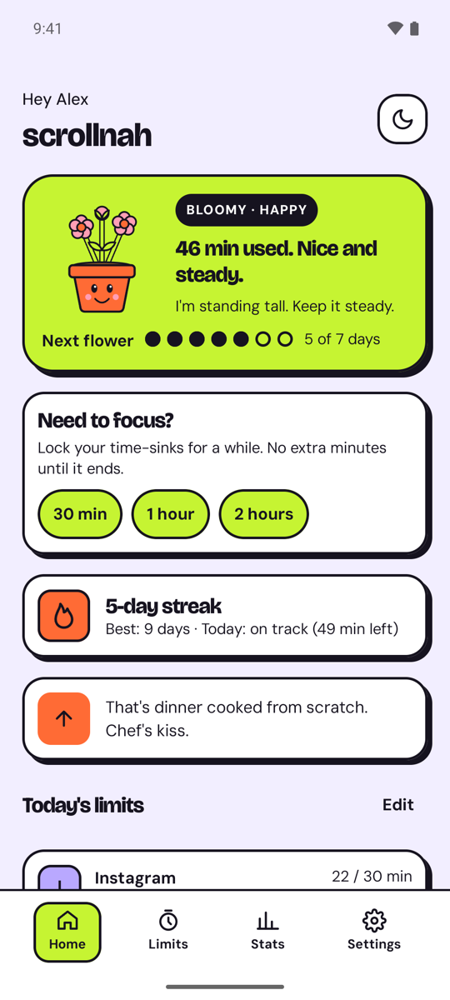 | 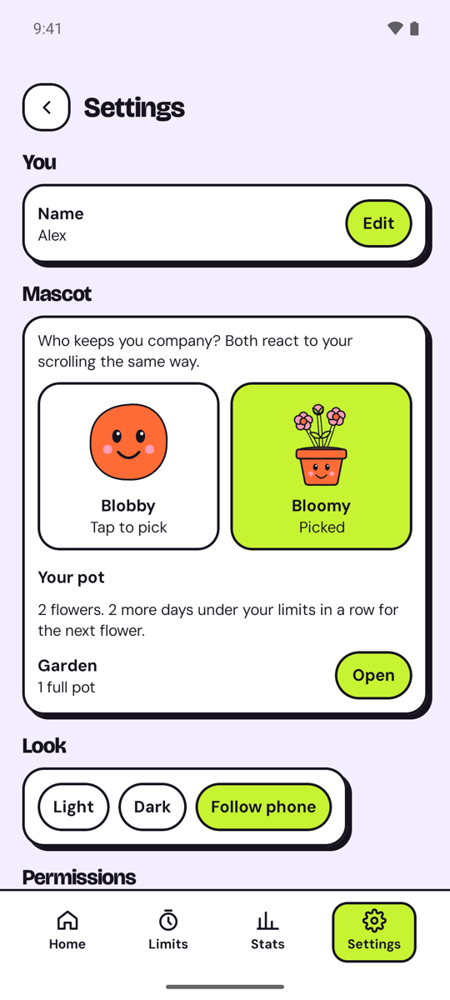 | 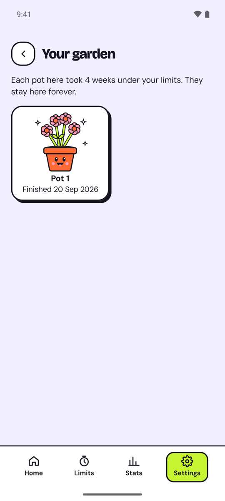 |
| **Pick your buddy (setup)** | **Bloomy grew a flower** | **Focus from Quick Settings** |
| 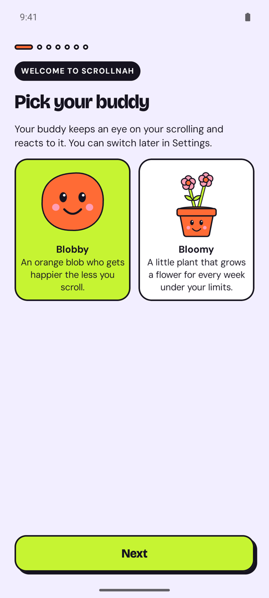 | 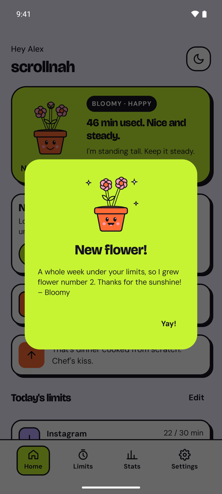 | 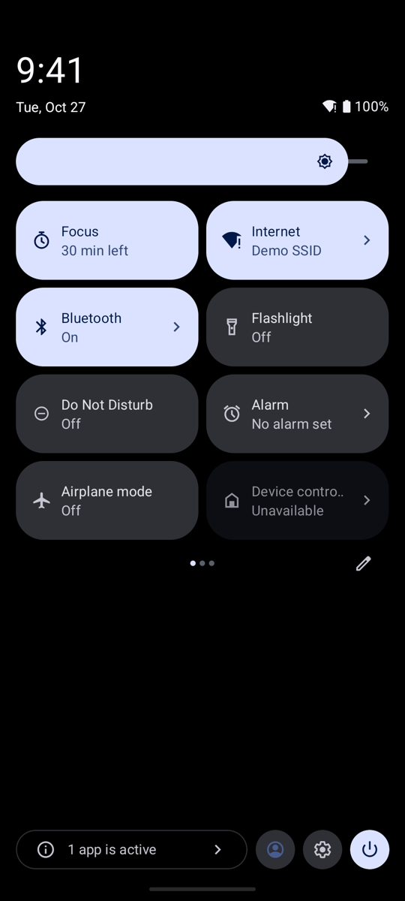 |
| **Home-screen widgets** | | |
| 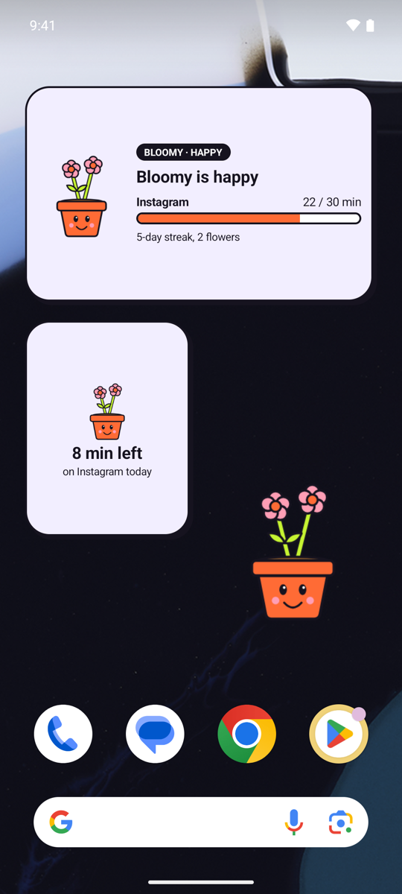 | | |

<sub>Screenshots use the app's sample data (debug demo mode). Apps that aren't installed on the test phone (Instagram, Snapchat) show a letter instead of their icon.</sub>

## Install

1. Open the [latest release](https://github.com/RAJASHEKARGUNAGANTI/scrollnah/releases/latest) on your phone and download the `.apk` file.
2. Open it and allow **Install unknown apps** for your browser or file manager when Android asks.
3. Follow the short setup in the app.

Good to know:
- Play Protect may warn about an app from outside the Play Store. That's expected for direct downloads.
- On Android 13+, the optional Reels/Shorts tracker can be greyed out at first: go to **Settings > Apps > ScrollNah > ⋮ > Allow restricted settings**, then turn it on.
- UPI and bank apps like BHIM may refuse to open while any app uses Accessibility, including the optional tracker. When that happens, ScrollNah's notification has a one-tap **Turn off tracker** button; turn it back on later in **Limits**.

## Feedback

Ideas, bugs or questions? Start a thread in [Discussions](https://github.com/RAJASHEKARGUNAGANTI/scrollnah/discussions). The app's **Settings > Send feedback** opens the same page.

## Build

Requirements: Android Studio (or JDK 17 + the Android SDK). Min Android 8.0 (API 26).

```bash
./gradlew assembleGithubDebug     # debug APK, GitHub version -> app/build/outputs/apk/github/debug/
./gradlew assembleGithubRelease   # release APK for GitHub releases (needs keystore.properties, see below)
./gradlew bundlePlayRelease       # Play Store bundle, without the Reels/Shorts tracker
```

There are two versions of the app from the same code: **github** (everything, including the optional Reels/Shorts & website tracker) and **play** (for Google Play, without the tracker, which uses an Accessibility service).

```bash
./gradlew testGithubDebugUnitTest # unit tests
```

Release signing reads a private `keystore.properties` file in the project root (not in this repo):

```
storeFile=keystore/your-release.jks
storePassword=...
keyAlias=...
keyPassword=...
```

## Tech

Kotlin + Jetpack Compose (Material 3, heavily restyled), Room, DataStore, plain RemoteViews widgets, a foreground service using `UsageStatsManager`, and (GitHub version only) an optional Accessibility service that only detects Reels/Shorts and browser address bars. Targets Android 16 (API 36).

Privacy policy: <https://rajashekargunaganti.github.io/scrollnah/privacy-policy> (source: [docs/privacy-policy.md](docs/privacy-policy.md), published with GitHub Pages from `main` > `/docs`).

Project notes for contributors: [`CLAUDE.md`](CLAUDE.md) (design and rules) and [`CLAUDE_UPDATES.md`](CLAUDE_UPDATES.md) (progress log).

## License

[MIT](LICENSE)
